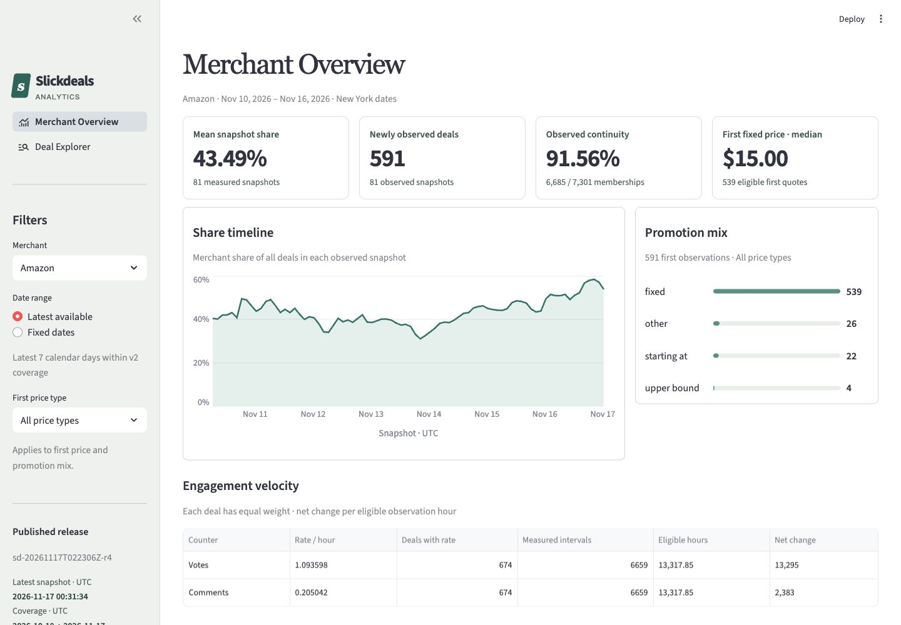
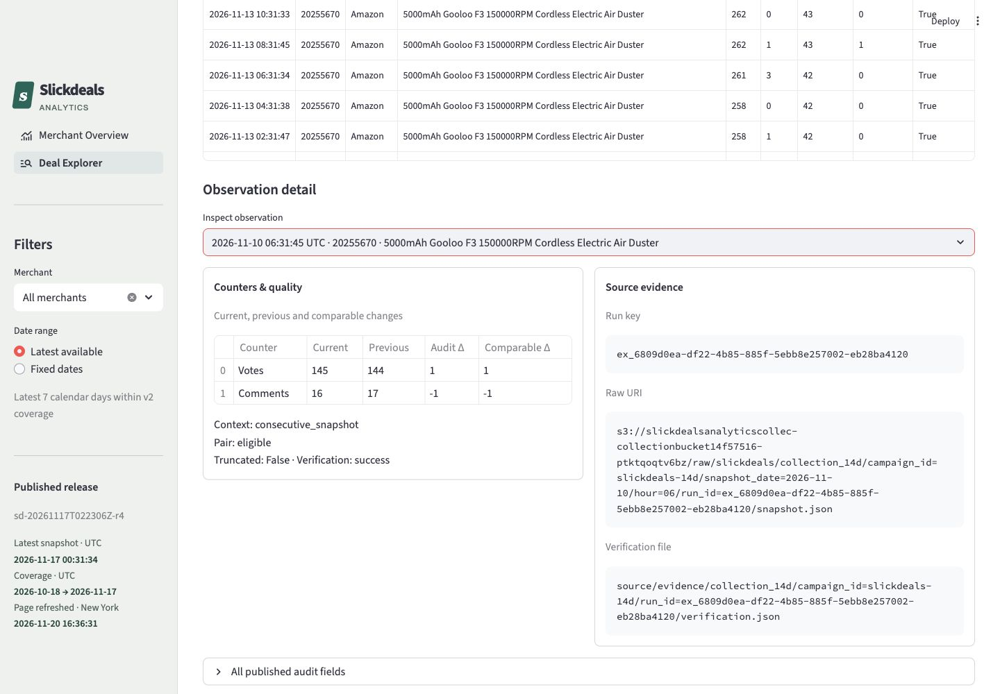

# Slickdeals Analytics Demo

**Turn changing web observations into reproducible, auditable analysis.**

I built a pipeline that collects timestamped Slickdeals Frontpage observations, verifies the saved source evidence, and exposes carefully defined metrics through a read-only dashboard. The engineering focus is data quality, explicit measurement rules, and tracing a result back to its inputs.



*Actual dashboard release r4; Amazon, November 10–16, 2026 (New York dates). Screenshot captured November 20. The public runnable demo uses separate, explicitly synthetic data.*

This public repository contains the reproducible analytics and dashboard portion of my larger Slickdeals platform. Production collection, infrastructure history and operational data remain in a separate private repository.

**Start here:** [Run the offline demo](analytics/README.md) · [Trace one metric](docs/application/metric-trace.md) · [Verified project status](docs/application/verification.md)

## What I implemented

- **Reliable collection:** scheduled AWS collection and independent verification of saved JSON/HTML, record counts, timestamps, and checksums; shared PySpark transformations retain source provenance.
- **Defensible metrics:** dbt models preserve snapshot adjacency, distinguish unknown counters from zero, retain signed counter changes, and exclude intervals that are not comparable.
- **Auditable delivery:** immutable DuckDB report packages bind data, SQL and contracts by hash. A Streamlit interface exposes merchant summaries and individual observation evidence through parameterized, read-only queries.

These observations describe public promotional content and displayed interaction counters. They are **not participant-level behavioral logs, impressions, sales, conversions, or evidence of a causal effect**.

## Current architecture

```mermaid
flowchart LR
    A[Public Frontpage HTML] --> B[MWAA Serverless + ECS Fargate]
    B --> C[S3 JSON, HTML and verification evidence]
    C --> D[Verified download + PySpark]
    D --> E[Versioned Clean Parquet]
    E --> F[dbt + DuckDB analytics]
    F --> G[Validated immutable report package]
    G --> H[Streamlit dashboard]
    H --> I[Observation-level audit]
```



Collection runs every two hours. Analytics builds and dashboard releases are separate steps; a new S3 snapshot does not automatically change the dashboard. Earlier EMR Serverless and Redshift implementations are historical work in the private platform repository, not the current serving path.

## Try it without AWS

```bash
python3.10 -m venv analytics/.venv
analytics/.venv/bin/python -m pip install -r analytics/requirements.txt
analytics/.venv/bin/python -B analytics/tools/build_demo.py
analytics/.venv/bin/python -m streamlit run analytics/bi/app.py
```

The demo creates fictional observations locally, runs the actual nine-model dbt graph and its tests, compiles the seven reports, and builds an isolated read-only package. No AWS credentials, production database, Java or sibling repository is required for this demo. [Details and validation commands](analytics/README.md).

## A result you can inspect

Amazon's mean per-Deal comment velocity for November 10–16 is **0.205042 comments per eligible observation hour** in r4. It uses 674 Deals and 6,659 measured intervals, including 14 negative counter changes. The metric first computes each Deal's signed rate, then gives each Deal equal weight. It is not total comment change divided by total hours.

[Follow the number from the dashboard to SQL, eligible intervals, and a saved verification hash →](docs/application/metric-trace.md)



## Verified state — November 20, 2026

| Artifact | Coverage and evidence |
|---|---|
| AWS collection | Scheduled; latest 50 checked executions succeeded. End date extended through December 5, New York time. |
| Latest downloaded batch | Through Nov 20 15:31:43 NY; 399 snapshots, 79,356 observations, 6,759 distinct Deals. Existing warehouse: 12 models + 81 data tests passed. |
| Published dashboard r4 | Through Nov 16 19:31:34 NY; 353 snapshots, 66,833 observations. Separate analytics graph: 9 models, 38 data tests + 6 unit tests. |
| New public demo | Fictional data; runs the same analytics models and compiled report queries. |

Counts above are versioned observations, not a live status badge. [Validation details and limits](docs/application/verification.md).

## Source map

| Directory | Purpose |
|---|---|
| `analytics/project/` | Dashboard analytics: staging, comparable intervals, four public marts and seven reports |
| `analytics/bi/` | Streamlit dashboard, release validation and SQL/UI regression tests |
| `analytics/demo/` | Reproducible synthetic-input schema; generated outputs stay untracked |
| `docs/application/` | Screenshots, metric walkthrough and dated validation summary |

The public demo starts at the Clean data contract. It does not simulate production web collection or claim to reproduce the full private S3 history. Production data, raw HTML, credentials and local report packages are not included in the demo.
